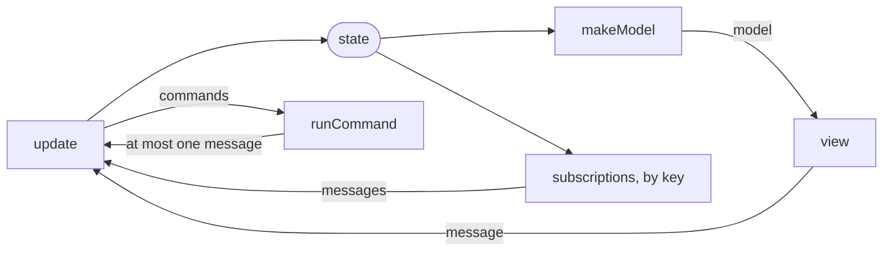

# @fgaudo/effect-tea

The Elm architecture on [Effect](https://effect.website) v4, for any renderer.

[Documentation](https://fgaudo.github.io/effect-tea/): this guide, the API in full and the examples running in
the browser.

You keep one **state**. A pure **`update`** changes it in response to messages. Effects are described as
data (**commands**) or listened to (**subscriptions**), never run inside `update`. The view draws a
**model**, made from the state, and sends messages.



What it adds to plain Elm:

- **`update` says what does not apply.** It may **reject** a message that makes no sense in the current state,
  and the run ignores it. A save that moves the form to "saving" then runs once, however fast the user taps. A
  message that cannot arrive is a bug instead: `defect` ends the run with it, where a rejection would hide it.
  The testing tools check, for the states a test generates, that the view sends only what `update` accepts, and
  leaves out nothing it accepts but what it withholds on purpose.
- **Composition is declared, not wired.** A parent says where each child lives in its state, and the library
  routes the children's messages, commands, subscriptions and models.
- **Views are cheap to memoize.** A child's model is the same object while its state object is, as long as
  `makeModel` is pure and states are replaced rather than mutated. `dispatchTo` gives its view the same
  dispatch in every frame.

## Contents

- [Installation](#installation)
- [Quick start](#quick-start)
- [Examples](#examples)
- [Guide](#guide): [anatomy](#anatomy-of-a-program), [update](#update), [model](#model), [view](#view),
  [commands](#commands), [subscriptions](#subscriptions), [rejections and defects](#rejections-and-defects),
  [composition](#composition), [splitting](#splitting-a-program), [running](#running),
  [guarantees](#guarantees), [testing](#testing)
- [API reference](#api-reference)

## Installation

```sh
bun add @fgaudo/effect-tea effect
```

`effect` (v4) is a peer dependency. The package ships JavaScript with declarations: use `moduleResolution`
`nodenext` or `bundler`. Under Bun, the `bun` export condition loads the TypeScript sources instead.

## Quick start

A counter that cannot go below zero. The "renderer" here only logs, and clicks "increment" until the count
reaches 3; [`examples/counter`](examples/counter) draws the same program with snabbdom.

```ts
import { type Program, reject, run, type Update } from '@fgaudo/effect-tea'
import * as Effect from 'effect/Effect'
import * as Stream from 'effect/Stream'

type State = Readonly<{ count: number }>

type Message = 'Increment' | 'Decrement'

const update: Update<State, Message> = (message) => ({ count }) => {
  if (message === 'Increment') return { state: { count: count + 1 } }
  if (count === 0) return reject // nothing to decrement
  return { state: { count: count - 1 } }
}

// At zero there is no `decrement`: the model's shape says so.
type Model =
  | Readonly<{ _tag: 'AtZero'; count: number; increment: Message }>
  | Readonly<{
    _tag: 'Counting'
    count: number
    increment: Message
    decrement: Message
  }>

const counter: Program<{ state: State; model: Model; message: Message }> = {
  init: { state: { count: 0 } },
  update,
  makeModel: ({ count }) =>
    count > 0
      ? {
        _tag: 'Counting',
        count,
        increment: 'Increment',
        decrement: 'Decrement',
      }
      : { _tag: 'AtZero', count, increment: 'Increment' },
}

const main = run(counter, (frames) =>
  frames.pipe(
    Stream.tap(Effect.fnUntraced(function*({ model, dispatch }) {
      yield* Effect.log(model.count)
      if (model.count < 3) yield* dispatch(model.increment)
    })),
    Stream.take(4),
    Stream.runDrain,
  ))

Effect.runFork(main) // logs 0, 1, 2, 3
```

What each piece is, and what else a program may have, is in the [Guide](#guide).

## Examples

[`examples/`](examples) holds complete programs, drawn with [snabbdom](https://github.com/snabbdom/snabbdom),
each with its tests. Try one in the browser, or run it with `bun run build`, then
`bun examples/<name>/index.html`.

| Example                       | What it is                   | What it shows                                                                                                       | Try it                                                        |
| ----------------------------- | ---------------------------- | ------------------------------------------------------------------------------------------------------------------- | ------------------------------------------------------------- |
| [`counter`](examples/counter) | the quick start, with a view | `applyAll`, `dispatchViolations`, `drive`                                                                           | [live](https://fgaudo.github.io/effect-tea/examples/counter/) |
| [`form`](examples/form)       | a form that saves a name     | an input the user owns while typing; a service; a failure as a message; a save only its completion ends; `rehearse` | [live](https://fgaudo.github.io/effect-tea/examples/form/)    |
| [`pages`](examples/pages)     | a clock and an About page    | `parent`, optics, `dispatchTo`, events, `subscribed`, a page started from flags; `simulate`                         | [live](https://fgaudo.github.io/effect-tea/examples/pages/)   |
| [`list`](examples/list)       | stopwatches by id            | `each`, a subscription per running child, `forEach`; a test with a `TestClock`                                      | [live](https://fgaudo.github.io/effect-tea/examples/list/)    |

[`examples/snabbdom.ts`](examples/snabbdom.ts) is the small bridge to the renderer, worth copying for your
own: `renderInto` for `run`, click and input handlers, and `messagesSentBy` for tests.
[`examples/snabbdom.test.ts`](examples/snabbdom.test.ts) runs it in a DOM, with
[happy-dom](https://github.com/capricorn86/happy-dom). It checks how often the bridge draws, and that what the
user types survives the frames drawn meanwhile.

## Guide

### Anatomy of a program

A program is a plain object with up to five pieces:

| Piece           | What it does                                                                               | Needed               |
| --------------- | ------------------------------------------------------------------------------------------ | -------------------- |
| `init`          | the first state and the commands to start with, or a function of its flags that makes them | always               |
| `update`        | `(message) => (state) =>` the next state, commands and events, or `reject`                 | always               |
| `makeModel`     | `(state) =>` what the view draws, with the messages it sends                               | always               |
| `runCommand`    | how each command happens, as an Effect                                                     | when it has commands |
| `subscriptions` | what it listens to in each state                                                           | when it listens      |

- **Its type names its types:** `Program<{ state; model; message }>`, plus `command`, `services`, `event`,
  `external` and `flags` when it has them.
- **Its state is always an object**, `{ count }` rather than `count`, so that any program can become a child as
  it is (see [composition](#composition)). A program whose state is a number or a string does not compile.
- **The view is not part of it.** `run` hands your renderer a stream of **frames** (`{ model, dispatch }`) to
  draw however it likes (see [view](#view)).
- **A program that cannot start the same way every time declares `flags`**, as in Elm, e.g. a page that shows
  the product it was opened for. Its `init` is then a function of them, `init: ({ id }) => ({ state, commands })`.
  Whoever starts the program gives them: a parent to its child (see [composition](#composition)), and `run` to
  the root (see [running](#running)).

### Update

`update` takes a message, then the state, and returns `{ state, commands?, events? }`, or `reject` when the
message makes no sense in that state. Events are for a parent (see [composition](#composition)). On a message
that cannot arrive, which is a bug, it throws with `defect(reason)`, and the run dies with it (see
[rejections and defects](#rejections-and-defects)).

- **Keep it pure.** It returns commands instead of running effects.
- **Never mutate the state**, nested objects included: return a new one. A message that returns the very same
  state draws no new frame.
- **Conditions live here.** "Can the user save now?" is answered once, by rejecting. The view never repeats
  the check.
- **Name intents, not toggles.** `MenuOpened` and `MenuClosed`, not `MenuToggled`. An intent sent twice does
  what it did once; a toggle undoes itself.
- **One-shot actions move to a state that rejects them.** After `SaveClicked` the form is saving and rejects
  a second `SaveClicked`, so a double click saves once.
- **One state machine per concern, no flags.** The save, the selection, the data being loaded: each is a union
  with a case per state (`Idle | Saving | Failed`), holding only what exists in it. Flags that combine
  (`isSaving`, `hasFailed`) allow combinations that cannot be; a union makes them fail to compile, and `update`
  matches on the case.
- **No derived data in the state.** What follows from it is computed in `makeModel`. A value that depends on
  time is computed there too, from a `now` that a subscription keeps in the state, as the clock of
  [`pages`](examples/pages/clock.ts) does.

### Model

`makeModel(state)` turns the state into what the view reads. Its **shape** says what the view shows: a case
for each state the view tells apart, each holding only what makes sense in it, the messages of its controls
included. In this example, `Message` is a `Data.TaggedEnum` and `isBlank` a helper of the program:

```ts
type Editor = Data.TaggedEnum<{
  Saving: object
  Blank: { changeName: (name: string) => Message }
  Named: {
    changeName: (name: string) => Message
    save: Message
  }
}>

const makeModel = (state: State): Editor => {
  const changeName = (name: string) => Message.NameChanged({ name })
  return state.save._tag === 'Saving'
    ? { _tag: 'Saving' }
    : isBlank(state.name)
    ? { _tag: 'Blank', changeName }
    : { _tag: 'Named', changeName, save: Message.SaveClicked() }
}
```

- **Pick the case from the state, as `update` reads it.** A model that shows "Save" where `update` rejects
  `SaveClicked` has a button that does nothing. The run does not check it; a test does, with the
  [testing](#testing) tools, for any state it generates.
- **Show less than `update` accepts, never more.** What it leaves out on purpose, a test lists as `withheld`
  (see [testing](#testing)); anything else left out is a control missing from the screen.
- **A view draws, it never decides.** It matches the model's tags and formats its values (a date, a count, a
  text). It computes no condition from data (`items.length === 0`), combines no fields, and applies no rule and
  no fallback. What a view would decide, `makeModel` decides, as a case named for the state the screen tells
  apart (`Empty | Listed`, `Loading | Loaded`), never a boolean. An `Option` is such a case only when
  "missing" is all the screen tells apart.
- **Input is never a reason to reject.** The input keeps what the user typed whatever `update` says (see
  [view](#view)), so a value `update` rejects would leave on screen a text the state does not have. Store what
  is typed, and make its validity model data: show "Save" only for a name that is not blank.

With its messages in the model, as here, a view sends only what the model holds. Export `Message` as a type
only, and no view can build one. A view may also build its messages itself, from a model of data alone. The
library does not mind, but a program reads more easily when it does one or the other.

### View

A view is `(model, dispatch) => Node`, and `dispatch` takes the program's messages. Sending returns an
`Effect<void>` that needs no services and completes synchronously. It only hands the message to the run, which
handles it with its own services. A renderer whose handlers are plain callbacks, like snabbdom's, runs it at
once with `Effect.runSync(dispatch(message))`, or with a runtime of its own: either is right.

The library ships no renderer. [`examples/snabbdom.ts`](examples/snabbdom.ts) is one, small enough to copy, and
a bridge to React or React Native is written the same way: draw each frame, and run `dispatch` in the handlers.

#### Inputs the user types into

A frame may be older than the user's last keystroke, so rewriting an input from every frame can eat what was
just typed. Let one side own the text at a time:

- **While the user types, the input owns it.** The view writes the text only when the input is created. The
  program learns it from the input's messages, which `update` accepts in every state where the input exists.
- **When the program replaces it** (e.g. clears the form after saving), it changes the input's `key`, so that
  the renderer creates a new input with the new text.

[`examples/field.ts`](examples/field.ts) packages this, and [`form`](examples/form) uses it. React Native
does the same with `defaultValue` and `key`.

### Commands

A command is **data** that says what `update` decided, usually a `Data.TaggedEnum`: `Command.Save({ name })`.
The program's `runCommand` turns it into an Effect that may produce one message back. Tests can then assert
the decision without running it:

```ts
expect(commands).toEqual([Command.Save({ name: 'Ada' })])
```

- **An execution cannot fail.** Its type (`Execution<Message, R>`, an `Effect<Option<Message>, never, R>`) says
  so. An expected failure becomes a message, as the success does, so that `update` decides what each means:
  `Effect.match`, then `Effect.asSome`, at the end of a `pipe` or an `Effect.fn`. A defect (`Effect.die`, a
  thrown error) ends the run. An effect that only acts on the world answers `None`: `Effect.as(effect,
  Opt.none())`.

  ```ts
  const save = Effect.fn('Save')(
    function*(name: string) {
      const storage = yield* Storage
      yield* storage.save(name)
    },
    Effect.match({
      onSuccess: () => Message.Saved(),
      onFailure: () => Message.SaveFailed(),
    }),
    Effect.asSome,
  )
  ```
- **A command carries everything it needs.** `runCommand` does not see the state. Its services are provided
  around `run`.
- **A command has a scope of its own.** What it acquires (`Effect.acquireRelease`, `Effect.forkScoped`) is
  released when it ends, before its message reaches `update`, so `run` never asks for a `Scope`. What must
  outlive a command is a service provided around `run`, or a subscription.
- **Commands cannot be cancelled.** Once started, a command runs to its end and its message arrives, even if
  the state has moved on. `update` then decides whether the answer still applies (see
  [rejections and defects](#rejections-and-defects)). Model the operation as a state that only its completion
  leaves, as [`form`](examples/form/form.ts) does: the state then cannot have moved on, and a completion
  anywhere else is a bug, a `defect`. This keeps commands plain data, and a save is never cut in half. Work that should
  stop is a [subscription](#subscriptions).

A command's services are its operations, and the layer around `run` their handlers. This is where a program
performs effects, in the algebraic sense, and where a handler lives. `update` performs none. What a child asks
of its parent is an event: data the parent handles after the child's step, never an operation the child resumes
from.

### Subscriptions

`subscriptions(state)` returns a `HashMap` of **subscriptions** by key: Effect `Channel`s of messages. After
every change of state the keys are compared by value:

- a new key starts its subscription;
- a kept key leaves it running;
- a missing key stops it, and drops what it sent that `update` has not seen.

A subscription never ends in silence. Either it never ends (a clock: its end value is `never`), or it ends with
**one last message**, its end value (a download done). An ended subscription is not restarted until its key
goes away and comes back. The type says all of it: a `Channel` whose end value is a message, written with
Effect's own combinators, as the clock of [`pages`](examples/pages/clock.ts) and the stopwatch of
[`list`](examples/list/stopwatch.ts) are. A `Stream` becomes one with `Stream.toChannel`,
`Channel.flattenArray` and `Channel.mapDone`, which asks what its end means.

| Use a…           | for                                                                                                                               |
| ---------------- | --------------------------------------------------------------------------------------------------------------------------------- |
| **subscription** | input tied to a state (a clock while a page is open, a scroll), or work that stops when the state no longer wants it (a download) |
| **command**      | a one-off effect whose answer must arrive even if the state has moved on                                                          |

**Work that should stop is a subscription.** A download, or a search while the user types, can be one: keep
its key in the state while the work is wanted. When the key goes away (the user cancels, or leaves the page)
the subscription is interrupted, and what it holds is released. Its last message says it finished.

A subscription sees the state only through its key: what it depends on goes into the key, and a new value
starts it anew. That is cheap for a timer whose interval changes. For something that should stay open while a
value it uses changes, such as a connection whose filter the user picks, split it three ways:

- the connection is a **service**: a layer provided to `run` opens it when the program starts and closes it
  when the run ends, so subscriptions and commands only use it;
- a **subscription** under a key that stays the same listens to what the service receives;
- a **command** sends the service the new value, when `update` decides that it changed.

```ts
// The service: one connection for the whole run.
class Feed extends Context.Service<Feed, {
  readonly items: Channel.Channel<Item, never, never>
  readonly filter: (filter: string) => Effect.Effect<void>
}>()('Feed') {}

// While the feed is open, one subscription listens, whatever the filter.
subscriptions: (state) =>
  state.feed._tag === 'Open'
    ? HashMap.make([
      'feed',
      Channel.unwrap(Effect.map(Effect.service(Feed), (feed) =>
        Channel.map(feed.items, (item) => Message.Received({ item }))
      )),
    ])
    : HashMap.empty(),

// A new filter is a command: the connection stays open.
runCommand: (command) =>
  Effect.flatMap(Effect.service(Feed), (feed) => feed.filter(command.filter)).pipe(
    Effect.as(Opt.none()),
  ),
```

### Rejections and defects

A message `update` cannot take in a state is one of two things:

|                       | `reject`                                                                                    | `defect(reason)`                                                                                               |
| --------------------- | ------------------------------------------------------------------------------------------- | -------------------------------------------------------------------------------------------------------------- |
| **For a message…**    | that may arrive, and does not apply in this state                                           | that cannot arrive: a bug                                                                                      |
| **For example**       | a tap on a frame the state has moved past; the answer of a command for a row since replaced | a completion outside the state only its completion leaves; a subscription's message in a state without its key |
| **What the run does** | ignores it, logs it at the debug level, tells `onIgnored`, and keeps the state              | dies with a `ProgramDefect` that says where, whose `cause` is an `InvariantDefect` holding the reason          |

**`reject` changes nothing.** A second click, or an answer that arrives once the state has moved on, leaves the
state as it was.

**`defect` makes a bug loud.** [`form`](examples/form/form.ts) throws it on a save that completes while nothing
is saving, where a rejection would hide the bug. The run dies as it dies with any defect (an `Effect.die`, a
thrown error: broken code). The `InvariantDefect` lets a crash report tell a broken rule of the program from
any other error. `defect` is an expression, for a branch of a ternary or a `Match`. It is for the synchronous
functions (`update`, `onEvent`, `makeModel`, `subscriptions`); inside an Effect, `Effect.die` stays.

"Cannot arrive" is a promise of the program's state, kept by the run. The state says that only a completion
leaves an operation, and a command answers once. The state stops listing a key, and the run drops what that
subscription sent. Nothing else makes that promise:

- **What the view draws never does.** A tap may come from a frame drawn before, from two fingers in one frame,
  or from a control still on screen while it animates away. A message of the view may arrive in any state, and
  is rejected where it does not apply, whatever the model showed.
- **An event keeps the timing of its cause.** A child that raises an event for a click raises it whenever the
  click comes, so the parent's `onEvent` cannot rule it out by its own state either. A handler answers with a
  step, and its type has no `reject`: one that does not apply answers `{ state }`, as [`pages`](examples/pages/app.ts)
  does when About is asked for while it is open. A completion promises something of the child's state, not of
  its parent's. An event raised for one rules out a parent's state only where the parent's own state promises
  it too.

To tell them apart, ask whether the message could reach that state while the program's code and the library's
are right. If a fast finger, a slow frame or another device is enough, it is a `reject`. If only a bug can
bring it there, it is a `defect`.

Whether the view sends only what applies, and all of it, is for the tests (see [testing](#testing)).

### Composition

A child is any program. A parent declares its children with `parent`, and the library does the routing:

```ts
const { child, compose } = parent<{ state: State }>()

const state = Optic.id<State>()

export const app = compose({
  init: (children) => ({
    state: { clock: children.Clock.init.state, maybeAbout: Opt.none() },
    commands: children.Clock.init.commands,
  }),
  children: {
    Clock: child(Clock.clock, {
      at: state.key('clock'),
      // Hidden under About, the clock keeps its state but stops ticking.
      subscribed: (state) =>
        Opt.isNone(state.maybeAbout) ? Opt.some(state.clock) : Opt.none(),
    }),
    // Closed, About is not there: the optic focuses nothing.
    About: child(About.about, { at: state.key('maybeAbout').compose(Optic.some()) }),
  },
  onEvent: {
    // About starts from the time the Clock showed, its flags; a double click opens it once.
    Clock: (event, children) => (state) => {
      if (Opt.isSome(state.maybeAbout)) return { state }
      const about = children.About.init({ openedAt: event.at })
      return {
        state: { ...state, maybeAbout: Opt.some(about.state) },
        commands: about.commands,
      }
    },
    About: () => (state) => ({ state: { ...state, maybeAbout: Opt.none() } }),
  },
  // Only the page on top is drawn.
  makeModel: (state, children) => ({
    page: Opt.isNone(state.maybeAbout)
      ? { _tag: 'Clock' as const, model: children.Clock(state) }
      : { _tag: 'About' as const, model: children.About(state) },
  }),
})
```

#### Declaring children

- **Where each child lives:** an optic into the parent's state, `at` (Effect's `Optic`: `Optic.id<State>()
  .key('clock')`, with `.compose(Optic.some())` for a child that may not be there), or the two functions an
  optic is, `get` and `set`. Where the optic focuses nothing, or `get` returns `None`, the child is not there.
- **When its subscriptions run:** `subscribed` (by default, whenever it is there).
- **How it starts:** a parent's `init` is a function of `children`, so that a child there from the start is
  started like any other. `children.Clock.init` holds its state and its commands, lifted; reading
  `Clock.clock.init.state` would leave its commands behind. A child with `flags` is started from them:
  `children.About.init({ openedAt })`, and `init(id, flags)` for children by id.
- **The parent's own flags**, if it has any, are declared as its other types,
  `parent<{ state: State; flags: Flags }>()`. Its `init` then returns the function that starts it:
  `init: (children) => (flags) => ({ state, commands })`.
- **What it draws:** `makeModel`, from its state and its children's models.
- **Its own messages, commands and subscriptions,** if it has any: `update`, `runCommand` (required exactly when
  it has commands of its own), `subscriptions`. Its `update` takes `children` too, and may reject its own
  messages as any `update` does.

What the library derives from it:

- **The parent's messages:** its own plus `{ _tag: <child>, message }` for each child. `MessageOf<typeof app>`
  names them. An own message that takes a child's name does not compile.
- **The parent's commands:** its own plus each child's, wrapped likewise and run by the child's `runCommand`.
- **The parent's subscriptions:** its own, plus each child's under `[<child>, key]` (`[<child>, id, key]` for
  children by id). `HashMap.has(subscriptionsOf(app)(state), ['Clock', 'ticks'])` tells a test whether the
  Clock ticks.
- **The children's models:** `children.About(state)` in `makeModel` is the child's model. It is the same object
  while the child's state is the same object, so a renderer can skip redrawing it (see `thunk` in
  [`pages`](examples/pages/view.ts)). A number or a string has no identity to keep a model by: this is why a
  program's state is always an object. Asking for the model of a child that is not there is a defect (a
  `CompositionDefect`).

#### Events and external messages

A parent and its children talk only through events and external messages.

- **A child raises an event** to ask its parent for something, like leaving the page. `onEvent` has one handler
  per child that has events, and is required exactly when one has, so that no event goes unhandled. An event
  the parent has nothing to say about, and its own parent handles, it raises as its own:
  `onEvent: { Products: raise }`, or `(_, event) => raise(event)` for children by id. Its `Event` then includes
  the child's, or this does not compile.
- **A parent sends an external message** to a child with `children.<child>.update`, in its own `update` and
  `onEvent`: one of the messages the child's type declares as `external` (e.g. a back button). The parent
  decides when to send, and the child's type says it takes the message. The child answers in every state, with
  its state or with an event, never with `reject`. A rejection there is a defect (a `CompositionDefect`, naming
  the child), as is sending to a child that is not there.

A back button closes what the page has open, or the page asks to be left:

```ts
// In the page: back always means something.
case 'BackPressed':
  return state.menu._tag === 'Open'
    ? { state: { ...state, menu: { _tag: 'Closed' } } }
    : { state, events: [{ _tag: 'LeaveRequested' }] }

// In its parent: what the page asks for, in the same step.
update: (_: BackPressed, children) => children.Page.update({ _tag: 'BackPressed' }),
onEvent: { Page: () => (state) => ({ state: leavePage(state) }) },
```

`children.Page.update` returns the parent's step, as a function of its state. To take a step of its own before
a child's, a parent adds them up:

- **`andThen`**: `andThen(leave(state), children.Home.update({ _tag: 'ProductGone', at }))`. The result has the
  second step's state, and both steps' commands and events, in order. Taking a step's `.state` by hand to make the
  next one drops its commands and its events.
- **`forEach`** is the `andThen` of many: one step for each item, each made from the state the previous one
  left, e.g. a message to every child by id,
  `forEach({ state }, state.rows, ({ id }) => children.Row.update(id, Cleared()))`.

Both take the step last as well, for a chain written with Effect's `pipe`:
`pipe({ state }, andThen(leave), forEach(ids, clear))`.

#### Children's views

A child's view sends the child's own messages, through a dispatch of its own: `dispatchTo(dispatch, 'Clock')`
wraps them as the parent receives them. It is the same function in every frame, so a view memoized on its
model and its dispatch is drawn again only when its model changes:

```ts
const view: View<Model, Message, VNode> = (model, dispatch) =>
  model.page._tag === 'Clock'
    ? thunk('main', 'clock', clockView, [
      model.page.model,
      dispatchTo(dispatch, 'Clock'),
    ])
    : thunk('main', 'about', aboutView, [
      model.page.model,
      dispatchTo(dispatch, 'About'),
    ])
```

A lambda that wraps the message, `(message) => dispatch({ _tag: 'Clock', message })`, sends the same messages,
but it is a new function in every frame: a view memoized on it is drawn every time. Use `dispatchTo` for every
child, memoized or not, and there is nothing to remember.

A grandchild's dispatch is made from its parent's: `dispatchTo(dispatchTo(dispatch, 'Home'), 'Products')`. A
view usually writes it in two steps, each view taking the dispatch its parent gave it.

#### Children by id

For children by id, such as the rows of a list, use `each` instead of `child`:

- `get` and `set` take the id (or `at` is a function of it);
- `subscribed` lists the rows that listen;
- `children.Row(state, id)` is a row's model, and `dispatchTo(dispatch, 'Row', id)` its dispatch.

Ids are compared by value, with `Equal`, wherever they go (subscription keys, dispatches): strings, numbers, or
tuples and structs of them. See [`list`](examples/list/list.ts).

**Mind ids that come back.** A command's answer goes to the id it was started for, to whichever row has that id
when it arrives. If a row is removed and another is added with its id, the new row may get the old row's
answer. Use ids that are never reused, or put in the message which row it is for, so that the new row's
`update` rejects the old answer. Subscriptions do not need this: a row that is removed stops them.

### Splitting a program

A program lives in one module until it is too large. Then it splits into children, each a program of its own:

- **By concern, never by kind.** `messages`, `state` and `update` modules would import each other in cycles.
- **What spans the children stays in the parent** (a menu, the back button). What concerns one child stays in
  the child, even how the user learns of its failure.
- **A parent never reads a child's state to decide.** What a child needs, it gets from its own services and
  subscriptions. Only a fact several children must see as one truth is the parent's, handed down as an
  external message.
- **Children that read each other's state are one child**, whatever its size. A child whose controls the parent
  would enable from its state, or whose state the parent would copy down and back up, is not one. A parent that
  grows logic between two siblings is a sign that they are one child.

### Running

`run(program, render, options?)` starts the program and hands `render` a stream of frames. The run ends when
the renderer ends. Only a program without events runs: there is no parent to handle them. A renderer slower
than the program only gets the latest frame, so a renderer that waits for the next animation frame before
taking another draws at most once per screen refresh, as [`examples/snabbdom.ts`](examples/snabbdom.ts) does.
Options:

- **`flags`**: what the program starts from, required exactly when it has them, e.g. the product a
  notification opened the app for.
- **`describeMessage`**, **`describeCommand`**: how messages and commands appear in the logs. By default only
  their tags, never their data: `Home › Products › Deleted`. They are called only while debug logs are enabled
  (`References.MinimumLogLevel`), so they cost nothing otherwise. The debug logs of subscriptions show their
  keys, which may hold data (an id, a search's text).
- **`onApplied`**: hears every accepted message with where it came from (`origin`: the view, a command, or a
  subscription with its key), the state before and after it, and the commands it started, for devtools or
  session recording.
- **`onIgnored`**: hears every message `update` rejected, with where it came from and the state it did not
  apply in. It only watches: the message stays ignored. For devtools, or to count the taps that did nothing.

The run logs only at the debug level: each message, a rejected one, and subscriptions starting, stopping and
ending. Effect's default minimum level, `Info`, hides them all.

A program starts where its `init` says. To start it elsewhere, from a state saved by `onApplied` or kept across
a reload in development, give `run` the program with another first step: `{ ...program, init: { state } }`
(its commands, if any, with it). A session recorded with `onApplied` plays again the same way, with `applyAll`
in a test.

A defect anywhere ends the run, which dies with a `ProgramDefect`:

- its `cause` is the defect itself, an `InvariantDefect` for one thrown with `defect`;
- `where` says where it happened, which only the run knows: `'update'` (`onEvent` included), with the message
  it was given as `on`, by its tags; `'subscriptions'`; `'subscription'`, with its `key`; `'command'`;
  `'render'` (the view and `makeModel` included); or one of the options, by name.

The run does not log it: reporting it is yours. In a browser, start it with `BrowserRuntime.runMain` from
`@effect/platform-browser`, and report crashes around it:

```ts
BrowserRuntime.runMain(
  run(app, render, options).pipe(
    Effect.tapCause((cause) => reportCrash(cause)),
  ),
)
```

### Guarantees

What you can rely on:

- **Outdated clicks are harmless.** A message `update` rejects is ignored: the state stays as it was, however
  many messages came in between.
- **Subscriptions follow their keys.** A subscription runs exactly while its key is in the state. When the key
  goes away, it is interrupted and releases what it holds, and nothing it sent reaches `update` afterwards,
  even if the same key comes back later.
- **Nothing outlives what acquired it.** Each command, each subscription and the renderer has a scope of its
  own. What it acquires is released when it ends or, when the run ends, once it has been interrupted, never
  while it still runs. The subscriptions one message stops are released together, and the next message waits
  for the slowest release, so keep them quick.
- **Logs do not pile up in a span.** What the run's fibers log is not kept by the span of whoever runs it
  (Effect keeps each log as an event of the current span until the span ends). That span is still the parent
  of the spans that commands and subscriptions open.
- **Nothing ends in silence.** A subscription that ends sends one last message. A defect anywhere ends the
  run, which dies with it, as a `ProgramDefect` that says where it happened.
- **Frames cost only what is drawn.** A message that returns the very same state draws no new frame, and a
  model is made only for the frames the renderer reads.

What is left to you:

- **Commands run to their end**, and their answer goes where it is addressed, even if the state has moved on.
  `update` decides whether it still applies (see [commands](#commands), and ids that come back in
  [children by id](#children-by-id)).
- **A slow renderer skips frames**: it gets only the latest one.
- **The view sends what `update` accepts, all of it but what it withholds on purpose.** The run does not check
  it: `dispatchViolations` does, in tests (see [testing](#testing)).
- **`update` and `makeModel` are pure, and states are never mutated.** The library reuses a child's model while
  its state is the same object.

The library's tests check each guarantee. [`src/interleaving.test.ts`](src/interleaving.test.ts) checks
them under random orders of clicks, command answers and subscription messages.

### Testing

Most of a program is pure, so most tests need no runtime.

#### How a program is tested

A program's tests follow its shape:

1. **Generate its states** with a property-testing library (fast-check in the examples): one arbitrary that
   produces only valid states, every case of each state machine among them.
2. **Check, for any of them,** that `update` answers every message with a step or `reject`, the same each time,
   that the view sends what `update` accepts (`dispatchViolations`), and what the program listens to
   (`subscriptionsOf`).
3. **Write one test per message**, asserting the next state, the commands and the events by value. Assert a
   rejection with `isRejected`, never as "the state did not change", which a step that keeps the state would
   pass too.
4. **Check the defects apart.** The pairs of state and message that the invariants rule out (see
   [rejections and defects](#rejections-and-defects)) are skipped above, and checked as defects:
   `expect(() => update(message)(state)).toThrow(InvariantDefect)`.

```ts
test('counts up and down', () => {
  expect(
    applyAll(update)(['Increment', 'Increment', 'Decrement'], { count: 0 })
      .state,
  )
    .toEqual({ count: 1 })
})

// For any count, the real view and `update` agree both ways.
test('the view sends what update accepts, all of it', () => {
  fc.assert(fc.property(fc.nat(1_000), (count) => {
    const sent = messagesSentBy<Model, Message>(
      view,
      counter.makeModel({ count }),
    )
    const check = dispatchViolations(update, { repeatable: () => true })
    expect(check({ count }, sent, ['Increment', 'Decrement'])).toEqual([])
  }))
})
```

- `program.makeModel(state)` makes a model as `run` does, so a property test can draw the view in any state,
  and `subscriptionsOf(program)(state)` says what the program listens to there.
- `messagesSentBy` is not in the package. It comes from the example bridge
  ([`examples/snabbdom.ts`](examples/snabbdom.ts)), which renders the view and fires every handler. A
  renderer of your own needs one like it.

#### The tools

From `@fgaudo/effect-tea/testing`:

| Tool                 | Use it to test                                                                   |
| -------------------- | -------------------------------------------------------------------------------- |
| `applyAll`           | `update`'s rules: apply messages, check the state, commands and events           |
| `dispatchViolations` | that the view sends what `update` accepts, all of it, and a double tap acts once |
| `simulate`           | a flow with its commands answered at once, without a runtime                     |
| `rehearse`           | a user's scenario without a runtime, the test deciding when each command runs    |
| `drive`              | a user's scenario on the running program, subscriptions included                 |

Where the test decides when each message arrives, a rejected message fails it if the test, or the view through
it, sent it. What arrives by itself is ignored, as when the program runs. In `drive` time is real, so every
rejection is ignored:

| Rejected…                           | a message the test or the view sends | a command's answer    | a subscription's message      |
| ----------------------------------- | ------------------------------------ | --------------------- | ----------------------------- |
| `applyAll`                          | fails the test                       | (commands do not run) | (the test sends it: it fails) |
| `simulate`                          | fails the test                       | ignored, in `ignored` | (the test sends it: it fails) |
| `rehearse`                          | fails the test                       | ignored, in `ignored` | ignored, in `ignored`         |
| `drive`, and the program as it runs | ignored                              | ignored               | ignored                       |

A tap on a frame that the state has since moved past is a message applied to a later state: test what it does
there with `applyAll`, or with `update` itself.

- **`applyAll`** takes only the test's messages, and fails when `update` rejects one of them.
- **`dispatchViolations`** checks both ways:
  - each message the view sends must be accepted (`Rejected`), and act once when sent twice (`ActsTwice`): sent
    again from the same frame, it is rejected or changes nothing, the same state by `Equal` with no commands and
    no events. Keep states data, since a value without structural equality compares by reference. Actions meant
    to repeat (a "+1") are marked `repeatable`;
  - of the `candidates` the test lists (what a user could ask for, with the text typed into each input), each one
    `update` accepts must be among those sent (`Missing`), except those `withheld` on purpose, e.g. typing while
    a save is in progress.

  Without candidates, it checks only what the view sends.
- **`simulate`** takes the test's messages and those a subscription would send among them, and fails when
  `update` rejects one of them. The command answers that `update` rejected are listed in `ignored`: assert it
  when one being dropped would be a bug.
- **`rehearse`** acts through what the current model shows, as `drive` does, but nothing runs by itself. Each
  command waits until the test runs it (`run`, `runAll`), through the program's `runCommand` with the services
  provided. A subscription's message is one the test says was heard (`hear`), or the first one the subscription
  itself sends when the test runs it (`hearNext`), only while its key is in the state. So a test says what the
  user does while a save is under way, and when its answer arrives:

  ```ts
  rehearse(
    form,
    Effect.fnUntraced(function*(rehearsal) {
      yield* rehearsal.send(({ editor }) =>
        editor._tag === 'Saving'
          ? Opt.none()
          : Opt.some(editor.changeName('Ada'))
      )
      yield* rehearsal.send(({ editor }) =>
        editor._tag === 'Named' ? Opt.some(editor.save) : Opt.none()
      )
      expect((yield* rehearsal.model).editor._tag).toBe('Saving')
      yield* rehearsal.run((command) => command._tag === 'Save')
    }),
  )
  ```

  It fails when `send` finds nothing to send on the model, when `update` rejects what it sends (a control the
  model shows and its own state rejects), and when a command is still pending at the end: its answer would
  still arrive. A command's or a subscription's message that no longer applies is ignored, as when the program
  runs, and listed in `ignored`. It starts from the program's `init`, or from the step given as `from`; a
  program with flags needs either `from` or its `flags`.
- **`drive`** sends what the frames show, through the run's dispatch, and fails on a wait longer than
  `patience` (2 seconds). Its time is real: a frame may be past by the time its message arrives. So, as when
  the program runs, a rejected message is ignored, and a scenario checks what it expects to see. A program with
  flags gets them as `run` does, in the options. Its commands run as soon as they start: to hold one, give the
  program a service of the test's that waits on a `Deferred` the scenario completes.

## API reference

Each export is documented in full in the [documentation](https://fgaudo.github.io/effect-tea/). From
`@fgaudo/effect-tea`:

| Export                                            | What it is                                                                                               |
| ------------------------------------------------- | -------------------------------------------------------------------------------------------------------- |
| `Program<{ state; model; message; command?; … }>` | `init`, `update`, `runCommand` (with commands), `subscriptions` (optional), `makeModel`                  |
| `StateOf`, `ModelOf`, `MessageOf`, `CommandOf`, … | a program's types, read back from it (`EventOf`, `ExternalOf`, `FlagsOf`, `ServicesOf`)                  |
| `parent`                                          | `parent<{ state; … }>()`: `child`, `each` and `compose`, to make a parent of children                    |
| `Update`, `Transition`, `Step`                    | `(message) => (state) => Step` or `Rejected`; a `Step` is `{ state, commands?, events? }`                |
| `reject`, `Rejected`, `isRejected`                | the rejection `update` returns, and its check                                                            |
| `defect`, `InvariantDefect`                       | `defect(reason)` throws an `InvariantDefect`: a message that cannot arrive, a defect                     |
| `andThen`, `forEach`                              | a step and the next made from its state, or one per item; dual                                           |
| `raise`                                           | `(event) => (state) => Step`: a child's event raised as the parent's own                                 |
| `Execution<Message, R>`, `RunCommand`             | `Effect<Option<Message>, never, R>`, how a command happens; `(command) => Execution`                     |
| `Subscription`                                    | a `Channel` of messages that never ends, or ends with one last message; kept by key                      |
| `Subscriptions`                                   | `(state) => HashMap<K, Subscription<Message>>`, reconciled by key                                        |
| `subscriptionsOf`                                 | what a program listens to in a state, by key, as `run` reconciles it                                     |
| `View`, `Dispatch`                                | `(model, dispatch) => Node`; `(message) => Effect<void>`, the same in every frame                        |
| `dispatchTo`                                      | a child's dispatch, for its view: wraps its messages as the parent receives them                         |
| `run`, `Frame`, `RunOptions`                      | run a program with a renderer; what the renderer draws; how the program runs                             |
| `Applied`, `Ignored`, `Origin`                    | what `onApplied` and `onIgnored` hear: a message, where it came from, the states around it               |
| `ProgramDefect`, `DefectSite`                     | the defect a run dies with: its `cause`, `where` it happened, `update`'s message, a subscription's `key` |
| `CompositionDefect`                               | a parent breaking what it declared of a child, which the run then dies with                              |

From `@fgaudo/effect-tea/testing`: `applyAll`, `simulate`, `Simulation`, `rehearse`, `Rehearsal`,
`RehearseOptions`, `drive`, `DriveOptions`, `Driver`, `dispatchViolations`, `DispatchViolation`.

## Development

`bun run typecheck`, `bun run lint` and `bun run test` check the package and the examples; `bun run build`
compiles it into `dist/`. Changes are in [`CHANGELOG.md`](CHANGELOG.md). The rules for contributors and coding
agents are in [`AGENTS.md`](AGENTS.md), and the procedures (changing the API, adding an example, upgrading
Effect, releasing and building the documentation site) in [`.agents/skills/`](.agents/skills).

## License

[MIT](LICENSE) © Francesco Gaudenzi
