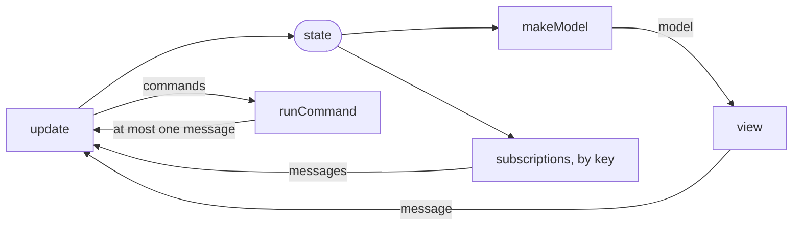

# @fgaudo/effect-tea

The Elm architecture on [Effect](https://effect.website) v4, for any renderer.

[Documentation](https://fgaudo.github.io/effect-tea/): the guide, the API in full and the examples running in
the browser.

New to it? The [tutorial](https://fgaudo.github.io/effect-tea/documents/Tutorial.html) builds an application step
by step.

[effect-tea-persistent](https://fgaudo.github.io/effect-tea-persistent/) brings the same architecture to long-lived
entities on a server, whose state a database keeps. It is experimental, and not published yet.

You keep one **state**. A pure **`update`** changes it in response to messages. Effects are described as
data (**commands**) or listened to (**subscriptions**), never run inside `update`. The view draws a
**model**, made from the state, and sends the messages it holds.



What it adds to plain Elm:

- **`update` says what does not apply.** It may **reject** a message that makes no sense in the current state,
  and the run ignores it. So a save that moves the form to "saving" runs once, however fast the user taps.
- **A bug is loud.** A message that cannot arrive is a bug. `update` throws `defect` on it, and the run dies
  instead of hiding it. The app, around the run, decides what the user sees next: a crash screen, or the
  program started again (see [running](https://fgaudo.github.io/effect-tea/documents/Guide.Running.html)).
- **The model is checked against `update`.** The testing tools check, for any state a test generates, that the
  model holds only what `update` accepts, and leaves out only what the test says it withholds.
- **Commands are your own data.** Elm's `Cmd` is opaque: a test cannot see what `update` decided. Here a command
  is a value of your own type, which `runCommand` turns into an Effect, so a test asserts it by value.
- **Composition is declared, not wired.** A parent says where each child lives in its state, and the library
  routes the children's messages, commands, subscriptions and models.

## Documentation

- The [tutorial](https://fgaudo.github.io/effect-tea/documents/Tutorial.html) builds an application step by step.
- The [Guide](https://fgaudo.github.io/effect-tea/documents/Guide.html) says what the library does and promises, one
  concept a page: [anatomy](https://fgaudo.github.io/effect-tea/documents/Guide.Anatomy_of_a_program.html),
  [update](https://fgaudo.github.io/effect-tea/documents/Guide.Update.html),
  [model](https://fgaudo.github.io/effect-tea/documents/Guide.Model.html),
  [view](https://fgaudo.github.io/effect-tea/documents/Guide.View.html),
  [inputs](https://fgaudo.github.io/effect-tea/documents/Guide.Inputs_the_user_types_into.html),
  [writing a bridge](https://fgaudo.github.io/effect-tea/documents/Guide.Writing_a_bridge.html),
  [commands](https://fgaudo.github.io/effect-tea/documents/Guide.Commands.html),
  [subscriptions](https://fgaudo.github.io/effect-tea/documents/Guide.Subscriptions.html),
  [rejections and defects](https://fgaudo.github.io/effect-tea/documents/Guide.Rejections_and_defects.html),
  [composition](https://fgaudo.github.io/effect-tea/documents/Guide.Composition.html),
  [structuring](https://fgaudo.github.io/effect-tea/documents/Guide.Structuring_a_program.html),
  [running](https://fgaudo.github.io/effect-tea/documents/Guide.Running.html),
  [guarantees](https://fgaudo.github.io/effect-tea/documents/Guide.Guarantees.html),
  [testing](https://fgaudo.github.io/effect-tea/documents/Guide.Testing.html).
- The [API](https://fgaudo.github.io/effect-tea/modules.html) documents each export in full.

## Installation

```sh
bun add @fgaudo/effect-tea effect
```

`effect` is a peer dependency, 4.1.4 or a newer 4.x. The package ships JavaScript with declarations: use
`moduleResolution` `nodenext` or `bundler`, and TypeScript 5.9 or newer, as Effect 4 does. Under Bun, the `bun`
export condition loads the TypeScript sources instead.

## Quick start

A counter that cannot go below zero. The "renderer" here only logs, and clicks "increment" until the count
reaches 3; [`examples/counter`](examples/counter) draws the same program with snabbdom.

```ts
import { type Program, reject, run, type Update } from '@fgaudo/effect-tea'
import * as Effect from 'effect/Effect'
import * as Stream from 'effect/Stream'

type State = Readonly<{ count: number }>

type Message = 'Increment' | 'Decrement'

const update: Update<State, Message> = (message) => ({ count }) => {
  if (message === 'Increment') return { state: { count: count + 1 } }
  if (count === 0) return reject // nothing to decrement
  return { state: { count: count - 1 } }
}

// At zero there is no `decrement`: the model's shape says so.
type Model =
  | Readonly<{ _tag: 'AtZero'; count: number; increment: Message }>
  | Readonly<{
    _tag: 'Counting'
    count: number
    increment: Message
    decrement: Message
  }>

const counter: Program<{ state: State; model: Model; message: Message }> = {
  init: { state: { count: 0 } },
  update,
  makeModel: ({ count }) =>
    count > 0
      ? {
        _tag: 'Counting',
        count,
        increment: 'Increment',
        decrement: 'Decrement',
      }
      : { _tag: 'AtZero', count, increment: 'Increment' },
}

const main = run(counter, (frames) =>
  frames.pipe(
    Stream.tap(Effect.fnUntraced(function*({ model, dispatch }) {
      yield* Effect.log(model.count)
      if (model.count < 3) yield* dispatch(model.increment)
    })),
    Stream.take(4),
    Stream.runDrain,
  ))

Effect.runFork(main) // logs 0, 1, 2, 3
```

What each piece is, and what else a program may have, is in the
[Guide](https://fgaudo.github.io/effect-tea/documents/Guide.html).

## Examples

[`examples/`](examples) holds complete programs, each with its tests, drawn with
[snabbdom](https://github.com/snabbdom/snabbdom), and two of them with React too. Try one in the browser, or run it
with `bun run build`, then `bun examples/<name>/index.html`.

| Example                                   | What it is                   | What it shows                                                                                                                                                | Try it                                                              |
| ----------------------------------------- | ---------------------------- | ------------------------------------------------------------------------------------------------------------------------------------------------------------ | ------------------------------------------------------------------- |
| [`counter`](examples/counter)             | the quick start, with a view | `applyAll`, `dispatchViolations`, `drive`                                                                                                                    | [live](https://fgaudo.github.io/effect-tea/examples/counter/)       |
| [`counter-react`](examples/counter-react) | the same program, in React   | what changes with the renderer: the view, `main.ts` and the bridge, never the program                                                                        | [live](https://fgaudo.github.io/effect-tea/examples/counter-react/) |
| [`form`](examples/form)                   | a form that saves a name     | an input declared in `compose`; a service; a failure as a message; a save only its completion ends; `rehearse`                                               | [live](https://fgaudo.github.io/effect-tea/examples/form/)          |
| [`form-react`](examples/form-react)       | the form, in React           | an input drawn by `Shows`, an uncontrolled `<input>` the bridge settles, never a `value` prop                                                                | [live](https://fgaudo.github.io/effect-tea/examples/form-react/)    |
| [`volume`](examples/volume)               | two sliders, side by side    | sliders the program draws, a drag a subscription keyed by the slider, for bounds that narrow; a key's messages given to `dispatchViolations`; `drive`        | [live](https://fgaudo.github.io/effect-tea/examples/volume/)        |
| [`pages`](examples/pages)                 | a clock and an About page    | `composition`, optics, `dispatchTo`, events, `subscribed`, a page started from flags; `simulate`                                                             | [live](https://fgaudo.github.io/effect-tea/examples/pages/)         |
| [`list`](examples/list)                   | stopwatches by id            | `each`, a subscription per running child, `forEach`; a test with a `TestClock`                                                                               | [live](https://fgaudo.github.io/effect-tea/examples/list/)          |
| [`timer`](examples/timer)                 | the tutorial's application   | timers by id, each ticking only while it runs, and a bell as a command; `rehearse` with `hear`                                                               | [live](https://fgaudo.github.io/effect-tea/examples/timer/)         |

## Development

`bun run typecheck`, `bun run lint` and `bun run test` check the package and the examples; `bun run build`
compiles it into `dist/`, and `bun run smoke` checks the packed package as Node and TypeScript consumers get it.
`bun run api` writes the report of the public API into `api/`, from `dist/`: it is committed, and the CI fails when
it differs from the declarations.
`bun run test:node` runs the library's tests on Node, whose engine is V8, where `bun run test` runs them on
JavaScriptCore.
`bun run mutations` takes out each check the engine's invariants rest on, one at a time, and fails when a test that
must catch it passes. `bun run interleavings` runs `src/interleaving.test.ts`, which `bun run test` leaves out: it
searches random histories from a seed drawn on each run, and the CI runs it every day.
Changes are in [`CHANGELOG.md`](CHANGELOG.md), open problems and possible improvements in
[`ROADMAP.md`](ROADMAP.md). The rules for contributors and coding agents are in
[`AGENTS.md`](AGENTS.md), and the procedures (changing the API, adding an example, upgrading Effect, releasing and
building the documentation site) in [`.agents/skills/`](.agents/skills).

## License

[MIT](LICENSE) © Francesco Gaudenzi
