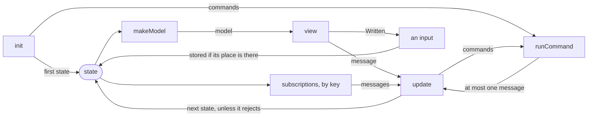

# Anatomy of a program

## In short

This page shows the pieces of a program and how they connect. The other pages of the guide describe each piece in
detail, so start here.

A program is a plain object, made with `program`. It has up to seven pieces:

- `init` says where the program starts.
- `update` says how each message changes the state.
- `makeModel` says what the view draws.
- `runCommand` is there when the program has commands.
- `external` is there when the program's parent may send it messages.
- `output` is there when the program's parent may read a value of it.
- `subscriptions` says what the program listens to in each state.

The view is not part of the program.

The pieces connect in a loop. Each message that `update` accepts makes the next state. A message that `update` rejects
leaves the state as it was. What the user types takes another path. The view writes it into an input declared in
`make`, and the library stores it without calling `update` (see [inputs](./inputs.md)).

## An example

The first program of the timer's tutorial is a duration in minutes (`examples/timer/duration.ts`). Here are its state
and its messages:

{@includeCode ../../examples/timer/duration.ts#state}

Its `update` is on the page [update](./update.md). Here is the program itself:

{@includeCode ../../examples/timer/duration.ts#program}

## Rules

| Piece           | What it does                                                                               | Needed                        |
| --------------- | ------------------------------------------------------------------------------------------ | ----------------------------- |
| `init`          | the first state and the commands to start with, or a function of its flags that makes them | always                        |
| `update`        | `(message) => (state) =>` the next state, commands and events, or `reject`                 | when it has messages          |
| `makeModel`     | `(state) =>` what the view draws, with the messages it sends                               | always                        |
| `runCommand`    | how each command happens, as an Effect                                                     | when it has commands          |
| `external`      | `(message) => (state) =>` the next state, commands and events, never `reject`              | when it has external messages |
| `output`        | `(state) =>` the value that its parent reads of it                                         | when it has an output         |
| `subscriptions` | what it listens to in each state                                                           | when it listens               |

- **Its types are named first, then it is made**: `program<{ state: State; message: Message }>().make({ … })`. Besides
  `state`, the types may name these:

  | Name       | What it names                          |
  | ---------- | -------------------------------------- |
  | `message`  | the program's messages                 |
  | `command`  | the program's commands                 |
  | `event`    | the events the program raises          |
  | `external` | the messages that a parent may send it |
  | `flags`    | the program's flags                    |
  | `output`   | what a parent reads of it              |
  | `model`    | the program's model                    |

  A type that the program does not name is a type that the program does not have. So:

  - A program that names no messages has no `update`, one that names no `external` messages has no `external`, and
    one that names no `output` has no `output`.
  - A program that raises an event it did not name does not compile.

  A model that is named is checked. A model that is not named is inferred from `makeModel`. The services are never
  named. They are inferred from `runCommand` and `subscriptions`. A command's effect or a subscription written apart
  names the services it needs in its own type, as `Execution<Message, R>` or `Subscription<Message, R>`. The program
  that returns it then needs them: `CommandServicesOf` and `SubscriptionServicesOf` give what a program needs.

- **Its type lists the types it is made of.** A program's type is `Program<{ state; model; message }>`. It also lists
  `command`, `commandServices`, `subscriptionServices`, `event`, `external`, `flags` and `output` when the program
  has them. `OutputOf<typeof program>` names its output.
  `make` returns this type, and a function that takes a program names this type.
- **Its state is always an object**: `{ count }` rather than `count`. So any program can become a child as it is (see
  [composition](./composition.md)).
- **The view is not part of it.** `start` gives your renderer an **`App`**, `{ model, subscribe, dispatch, die }`: the
  model of the current state, and a notice of each new state. The library does not say how the renderer draws the model.
  What the renderer must keep to is in [view](./view.md).
- **A program that cannot start the same way every time declares `flags`**, as in Elm. For example, a page that shows
  the product it was opened for declares flags.

## Precisely

**What does not compile.** The compiler refuses three kinds of program. Each kind is refused in the places below:

- A state that is a number or a string. It is refused by `Program<…>` and `program`, by `child` and `childById`, by
  `start`, and by `simulate`, `rehearse` and `drive`.
- A state whose type has no fields, such as `{}`. Such a type holds a number too, so name the type of a state without
  fields `object`. `program` accepts such a state, and `make` refuses it. A program written as an object is refused
  when it is typed `Program<…>`, and when `child`, `childById`, `start`, `simulate`, `rehearse` or `drive` takes it.
  - A state that is a type parameter, such as `S` in `<S extends object>(state: S) => program<{ state: S }>()`, is
    refused by `make` too: the compiler cannot decide that `S` holds no number. A type parameter in a field of the
    state, such as `A` in `{ items: ReadonlyArray<A> }`, compiles.
- A program written as an object without `subscriptions`. It is refused when it is typed `Program<…>`, and when
  `child`, `childById`, `start`, `rehearse` or `drive` takes it. `simulate` refuses the pieces of a program without
  `subscriptions` too. `make` accepts a program without them, and the program it returns has them.

**The types need `strict`.** The library's types are checked under the compiler option `strict` alone. Without
`strictFunctionTypes`, which `strict` turns on, the compiler accepts programs that it should refuse. For example, it
accepts a program typed with more `external` messages than the program takes.

**`runCommand` is required exactly when the program has commands.** So every command has a `runCommand` that
interprets it. In the same way, `external` is required exactly when the program has external messages (see
[events and external messages](./events-and-external-messages.md#precisely)).

**A test makes a model as the run does.** The run makes the model of a state with `program.makeModel(state)`. A test can
call `program.makeModel` the same way, on any state. It reads a program's output the same way, as
`program.output(state)`: no tool reads the output of a program that has no parent.

**What a program listens to.** `program.subscriptions(state)` is what the program listens to in `state`, by key.
It is what the run reconciles. For a program made without `subscriptions`, it is empty. A parent lists the subscriptions
of each child under `[<child>, instance, key]`. For children by id, the parent lists them under
`[<child>, id, instance, key]` (see [what the library derives](./composition.md#what-the-library-derives)).

**A program with flags.** Its `init` is a function of the flags: `init: ({ id }) => ({ state, commands })`. It is
pure, as `update` is: a child's `init` runs in its parent's `update` when a step starts the child (see
[what is left to you](./guarantees.md#what-is-left-to-you)). Whoever starts the program gives the flags:

- A parent gives them to its child, from its own state (see [composition](./composition.md#when-a-child-is-there)).
- `start` gives them to the root (see [running](./running.md)).
