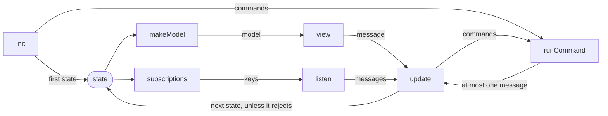

# Anatomy of a program

## In short

This page shows the pieces of a program and how they connect. The other pages of the guide describe each piece in
detail, so start here.

A program is a plain object, made with `program`. It has up to eight pieces:

- `init` says where the program starts: its first state, and the commands to start with.
- `update` says how each message changes the state.
- `makeModel` says what the view draws.
- `runCommand` is there when the program has commands, and says how each one happens.
- `external` is there when the program's parent may send it messages.
- `output` is there when the program's parent may read a value of it.
- `subscriptions` says what the program listens to in each state, as keys.
- `listen` makes the subscription of a key, when the program has keys.

The view is not part of the program.

The pieces connect in a loop. Each message that `update` accepts makes the next state. A message that `update` rejects
leaves the state as it was. What the user types is a message too: the model holds it without its value, and the view
fills it (see [what an element gives](./what-an-element-gives.md)).

## An example

The first program of the timer's tutorial is a duration in minutes (`examples/timer/duration.ts`). Here are its state
and its messages:

{@includeCode ../../examples/timer/duration.ts#state}

Its `update` is on the page [update](./update.md). Here is the program itself:

{@includeCode ../../examples/timer/duration.ts#program}

## Rules

- **Its types are named first, then it is made**: `program<{ state: State; message: Message }>().make({ … })`. Besides
  `state`, the types may name these:

  | Name       | What it names                          |
  | ---------- | -------------------------------------- |
  | `message`  | the program's messages                 |
  | `command`  | the program's commands                 |
  | `event`    | the events the program raises          |
  | `external` | the messages that a parent may send it |
  | `flags`    | the program's flags                    |
  | `output`   | what a parent reads of it              |
  | `key`      | the keys of its subscriptions          |
  | `model`    | the program's model                    |

  A type that the program does not name is a type that the program does not have: a program that names no `message`
  has no `update`, and one that names no `key` has no `subscriptions` and no `listen` in `make`. A model that is named
  is checked, and one that is not named is inferred from `makeModel`. The services are never named: they are inferred
  from `runCommand` and `listen`.
- **Its type lists the types it is made of**: `Program<{ state; model; message }>`, with the others that it has. `make`
  returns this type, and a function that takes a program names it. `StateOf<typeof program>`, `MessageOf` and the
  others read a type back.
- **The view is not part of it.** `start` gives your renderer an `App`: the model of the current state, and a notice of
  each new state (see [running](./running.md)). What the renderer must keep to is in [view](./view.md).
- **A program that cannot start the same way every time declares `flags`**, as in Elm, such as a page that shows the
  product it was opened for. Its `init` is then a function of them: `init: ({ id }) => ({ state, commands })`. It is
  pure, as `update` is (see [what is left to you](./guarantees.md#what-is-left-to-you)). A parent gives a child its
  flags, from its own state (see [composition](./composition.md)), and `start` gives the root its own (see
  [running](./running.md)).
- **The types need `strict`.** The library's types are checked under the compiler option `strict` alone. Without
  `strictFunctionTypes`, which `strict` turns on, the compiler accepts programs that it should refuse.

What the compiler refuses of a program is in the doc comments of `program` and of `Program`.
