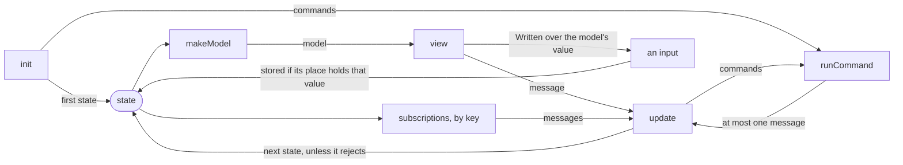

# Anatomy of a program

## In short

A program is a plain object with up to five pieces. `init` says where it starts, `update` how each message changes the
state, and `makeModel` what the view draws. `runCommand` and `subscriptions` are there when the program has commands or
listens to something. The view is not part of the program.

They connect in a loop. Each message that `update` accepts makes the next state, and a message that it rejects leaves
the state as it was. What the user types takes another path: the view writes it into an input declared in `make`, and
the library stores it without calling `update` (see [inputs the user types into](./inputs-the-user-types-into.md)).

## An example

The first program of the timer's tutorial, a duration in minutes (`examples/timer/duration.ts`). Its state and
messages:

{@includeCode ../../examples/timer/duration.ts#state}

Its `update` is on [update](./update.md). The program itself:

{@includeCode ../../examples/timer/duration.ts#program}

## Rules

| Piece           | What it does                                                                               | Needed               |
| --------------- | ------------------------------------------------------------------------------------------ | -------------------- |
| `init`          | the first state and the commands to start with, or a function of its flags that makes them | always               |
| `update`        | `(message) => (state) =>` the next state, commands and events, or `reject`                 | always               |
| `makeModel`     | `(state) =>` what the view draws, with the messages it sends                               | always               |
| `runCommand`    | how each command happens, as an Effect                                                     | when it has commands |
| `subscriptions` | what it listens to in each state                                                           | when it listens      |

- **Its type lists the types it is made of.** It is `Program<{ state; model; message }>`, plus `command`,
  `commandServices`, `subscriptionServices`, `event`, `external` and `flags` when it has them.
- **Its state is always an object**: `{ count }` rather than `count`. That way any program can become a child as it is
  (see [composition](./composition.md)).
- **The view is not part of it.** `run` hands your renderer a stream of **frames** (`{ model, dispatch, seen }`). The
  renderer draws them however it likes (see [view](./view.md)).
- **A program that cannot start the same way every time declares `flags`**, as in Elm. An example is a page that shows
  the product it was opened for.

## Precisely

**What does not compile.** A program whose state is a number or a string does not compile. Nor does one whose
`external` messages are not among its `message`s.

**`runCommand` is required exactly when the program has commands.** So no command goes uninterpreted.

**A test makes a model as `run` does.** `run` makes a frame's model with `program.makeModel(state)`, and a test can
call it the same way, on any state.

**What a program listens to.** `subscriptionsOf(program)(state)` is what the program listens to in `state`, by key, as
`run` reconciles it. It is empty for a program without `subscriptions`. A parent lists the subscriptions of each child
under `[<child>, key]`, or under `[<child>, id, key]` for children by id (see [composition](./composition.md)).

**A program with flags.** Its `init` is a function of them: `init: ({ id }) => ({ state, commands })`. Whoever starts
the program gives them. A parent gives them to its child (see [composition](./composition.md)), and `run` to the root
(see [running](./running.md)).
